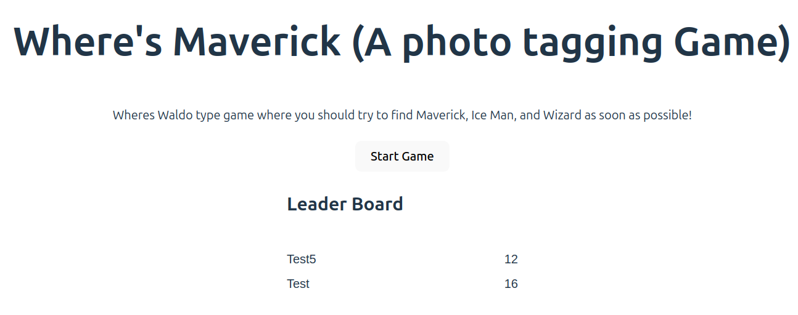
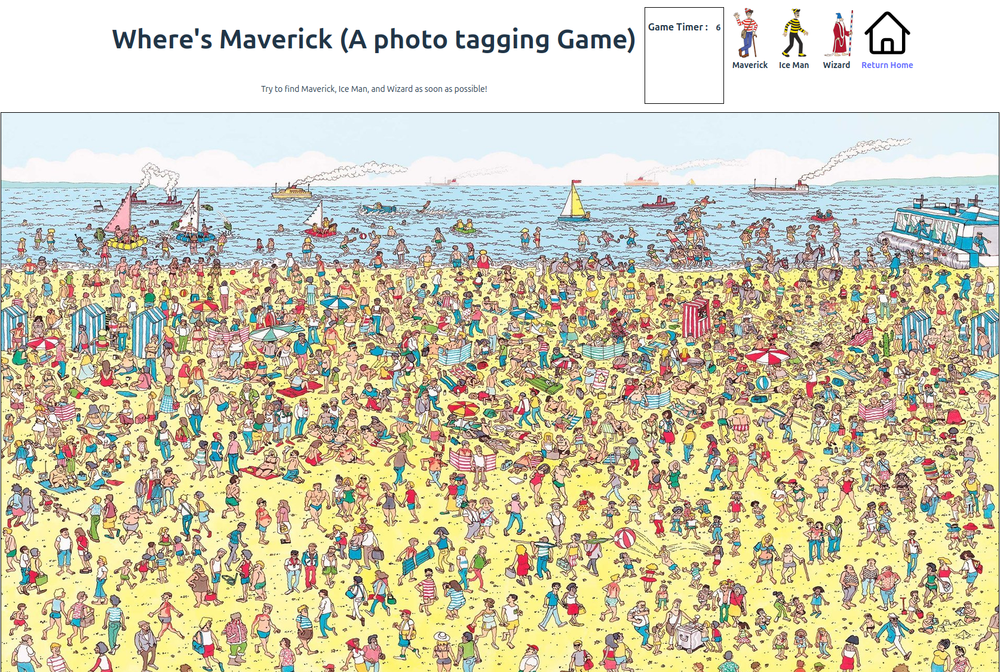
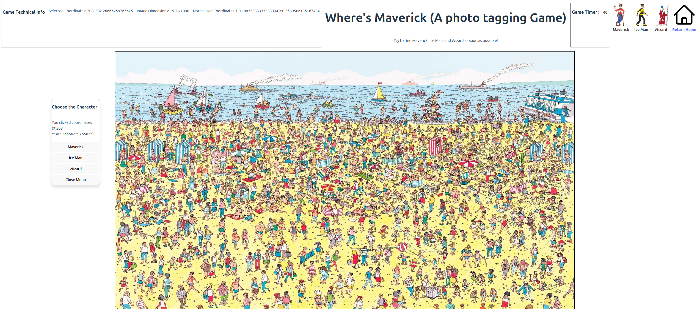
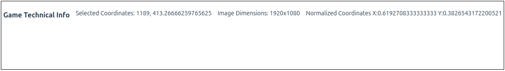
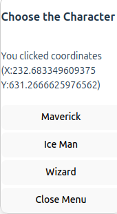
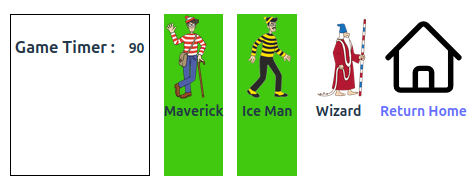
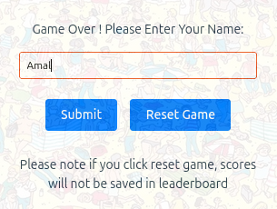

# Full Stack Photo Tagging Game

A full-stack photo tagging game built with React, Node.js and Express, where players locate hidden characters in a photograph and compete to complete the challenge in the fastest time.

## Table of Contents

- [Overview](#overview)

- [Features](#features)

- [Live Demo](#live-demo)

- [Source Code](#source-code)

- [Tech Stack](#tech-stack)

- [Architecture](#architecture)

- [Getting Started](#getting-started)
  - [Prerequisites](#prerequisites)

  - [Installation](#installation)

  - [Environment Variables](#environment-variables)

- [Project Structure](#project-structure)

- [Available Scripts](#available-scripts)

- [Development](#development)

- [Testing](#testing)

- [API Reference](#api-reference)

- [Deployment](#deployment)

- [Troubleshooting](#troubleshooting)

- [Contributing](#contributing)

- [License](#license)

- [Acknowledgements](#acknowledgements)

- [Contact](#contact)

---

## Overview

Full Stack Photo Tagging Game is a browser-based game designed to strengthen technical proficiency in building full-stack applications.

The game is inspired by photo-tagging games where players are presented with a large photograph containing several characters they need to identify, such as Maverick, The Wizard and Ice Man.

Players select locations within the photograph and choose the character they believe is located there. The application validates their selections and provides feedback indicating whether they have identified the correct character.

Each character's position is defined using pixel coordinates. When a player selects an area of the photograph, the application checks whether the selected character is actually located within the targeted area.

Once a character is correctly identified, a marker is placed on the photograph.

The game also tracks how long it takes players to identify all the characters. When a round is completed, players can enter their name and record their completion time.

## Features

- **Interactive Photo Tagging:** Players can select locations within a large photograph to identify hidden characters.

- **Character Selection:** Display a selection box containing possible characters when a player clicks on the photograph.

- **Coordinate Validation:** Validate character selections against their predefined pixel positions.

- **Instant Feedback:** Inform players whether their character selection is correct or incorrect.

- **Visual Markers:** Display markers on the photograph when characters are successfully identified.

- **Game Timer:** Track the time from when the photograph is first loaded until all characters are identified.

- **Score Recording:** Allow players to submit their names and completion times after finishing a round.

## Screenshots









## Live Demo : [Play the Game](https://amalk.au/full-stack-photo-tagging-game)

Try the application:

| Component | Platform     | URL                                                                        |
| --------- | ------------ | -------------------------------------------------------------------------- |
| Frontend  | GitHub Pages | [Play the Game](https://amalk.au/full-stack-photo-tagging-game)            |
| Backend   | Render       | [Backend Application](https://full-stack-photo-tagging-game.onrender.com/) |

> **Note:** The backend uses a free hosting tier. The service may take up to 60 seconds to respond when waking from inactivity.

## Source Code

The original source code references are retained below.

- **Main GitHub Repository:** [Full Stack Photo Tagging Game](https://github.com/amalk-au/full-stack-photo-tagging-game)

- **Frontend Source Code:** [Frontend Repository](https://github.com/amalk-au/full-stack-photo-tagging-game/tree/main/frontend)

- **Backend Source Code:** [Backend Repository](https://github.com/amalk-au/full-stack-photo-tagging-game/tree/main/backend)

## Tech Stack

### Frontend

| Technology | Purpose                                |
| ---------- | -------------------------------------- |
| JavaScript | Application programming language       |
| React      | Frontend UI library                    |
| Vite       | Frontend development and build tooling |
| HTML       | Application structure                  |
| CSS        | Application styling                    |

### Backend

| Technology | Purpose                     |
| ---------- | --------------------------- |
| Node.js    | JavaScript runtime          |
| Express    | Backend framework           |
| Postman    | API development and testing |

## Architecture

The application follows a client-server architecture consisting of a React frontend and a Node.js backend.

### Frontend

The frontend is responsible for:

- Rendering the photograph and game interface.

- Handling player interactions and character selections.

- Displaying character markers and validation feedback.

- Tracking the player's completion time.

- Communicating with the backend.

### Backend

The backend is responsible for:

- Handling application requests through Express.

- Processing character validation requests.

- Supporting the application's server-side functionality.

- Managing game-related data.

### Game Flow

1.  The player loads the game photograph.

2.  The game starts tracking the elapsed time.

3.  The player clicks a location within the photograph.

4.  A selection box displays the available characters.

5.  The player selects a character.

6.  The application validates the selection against the character's predefined coordinates.

7.  If correct, a marker is displayed on the photograph.

8.  The process continues until all characters are identified.

9.  The player enters their name and records their completion time.

## Getting Started

Follow these instructions to set up and run the project locally.

### Prerequisites

Make sure you have the following installed:

- [Node.js](https://nodejs.org/)

- pnpm

- Git

- A modern web browser

### Installation

**1\. Clone the repository**

Clone the current repository:

```
git clone https://github.com/amalk-au/full-stack-photo-tagging-game.git

cd full-stack-photo-tagging-game
```

**2\. Install frontend dependencies**

```
cd frontend

pnpm install
```

**3\. Install backend dependencies**

Open another terminal from the project root:

```
cd backend

pnpm install
```

**4\. Configure environment variables**

Create the backend `.env` file and configure the required environment variables.

Example local configuration:

```
PORT=5000
CORS_URL=http://localhost:5173
```

Adjust these values to match your local configuration.

**5\. Start the backend**

From the backend directory:

```
pnpm run dev
```

**6\. Start the frontend**

From the frontend directory:

```
pnpm run dev
```

Open the local URL provided by Vite in your browser.

## Environment Variables

The backend uses environment variables for server configuration.

| Variable   | Description                     | Required |
| ---------- | ------------------------------- | -------- |
| `PORT`     | Port used by the Express server | No       |
| `CORS_URL` | Allowed frontend origin         | Yes      |

Never commit secrets, credentials or production environment files.

## Project Structure

The project separates the frontend and backend into their own applications.

```
full-stack-photo-tagging-game/
│
├── frontend/
│   ├── public/
│   ├── src/
│   ├── package.json
│   └── vite.config.js
│
├── backend/
│   ├── routes/
│   │   └── mainRouter.js
│   ├── index.js
│   └── package.json
│
├── .gitignore
├── LICENSE
└── README.md
```

## Available Scripts

### Frontend

Run these commands from the `frontend` directory.

| Command            | Description                         |
| ------------------ | ----------------------------------- |
| `pnpm run dev`     | Start the Vite development server   |
| `pnpm run build`   | Build the frontend for production   |
| `pnpm run preview` | Preview the production build        |
| `pnpm run lint`    | Run ESLint                          |
| `pnpm run deploy`  | Deploy the frontend to GitHub Pages |

### Backend

Run these commands from the `backend` directory.

| Command        | Description                          |
| -------------- | ------------------------------------ |
| `pnpm start`   | Start the Express server             |
| `pnpm run dev` | Start the server in development mode |

## Development

When contributing to the project:

1.  Create a feature branch.

2.  Implement changes following the existing code conventions.

3.  Run linting and build commands.

4.  Test the application locally.

5.  Commit your changes with descriptive commit messages.

6.  Open a pull request.

Keep changes focused, maintainable and well-documented.

## Testing

Frontend code quality can be checked using ESLint:

```
cd frontend

pnpm run lint
```

Verify the production build:

```
pnpm run build
```

Backend API endpoints can be tested using Postman.

## API Reference

The backend exposes its functionality through an Express API.

**Local Base URL:**

```
http://localhost:5000
```

**Production Base URL:**

```
https://full-stack-photo-tagging-game.onrender.com/
```

For available endpoints, request methods, parameters and response formats, refer to the backend route definitions.

```
backend/routes/mainRouter.js
```

## Deployment

The application uses separate hosting providers for the frontend and backend.

### Frontend – GitHub Pages

The frontend is hosted using GitHub Pages.

To deploy the frontend:

```
cd frontend

pnpm install

pnpm run deploy
```

The deployment script builds and publishes the frontend application.

**Live URL:**

[https://amalk.au/full-stack-photo-tagging-game](https://amalk.au/full-stack-photo-tagging-game)

### Backend – Render

The backend is hosted on Render.

The production backend is available at:

[https://full-stack-photo-tagging-game.onrender.com/](https://full-stack-photo-tagging-game.onrender.com/)

Configure the necessary environment variables in the Render dashboard.

> **Note:** Free hosting tiers may cause delays of up to 60 seconds when the backend receives its first request after a period of inactivity.

## Troubleshooting

| Issue                                    | Possible Solution                                                   |
| ---------------------------------------- | ------------------------------------------------------------------- |
| Dependencies fail to install             | Check your Node.js and npm versions, then run `pnpm install` again. |
| Backend fails to start                   | Check the environment variables and installed dependencies.         |
| CORS errors                              | Verify that `CORS_URL` matches the frontend origin.                 |
| Frontend cannot communicate with backend | Check the backend URL and ensure the server is running.             |
| GitHub Pages deployment fails            | Check repository permissions and deployment configuration.          |
| Frontend assets fail to load             | Verify the Vite base path configuration.                            |
| Backend takes a long time to respond     | The Render free hosting tier may need time to wake from inactivity. |

## Contributing

Contributions, suggestions and bug reports are welcome.

1.  Fork the repository.

2.  Create a feature branch.

3.  Implement and test your changes.

4.  Commit your changes.

5.  Open a pull request.

For significant changes, open an issue first to discuss the proposed implementation.

## License

This project is licensed under the GNU General Public License v3.0 (GPL-3.0).

See the [LICENSE](./LICENSE) file for the full licence text.

## Acknowledgements

- Inspired by photo-tagging and hidden-object games.

- Built as a full-stack web development project to strengthen frontend and backend development skills.

- Thanks to the open-source communities behind React, Node.js, Express and Vite.

## Contact

- **Author:** Amal K.

- **GitHub:**[@amalk-au](https://github.com/amalk-au)

- **Issues:**[GitHub Issues](https://github.com/amalk-au/full-stack-photo-tagging-game/issues)

---

<p align="center">Developed by <a href="[https://github.com/amalk-au](https://github.com/amalk-au)">amalk-au</a></p>
